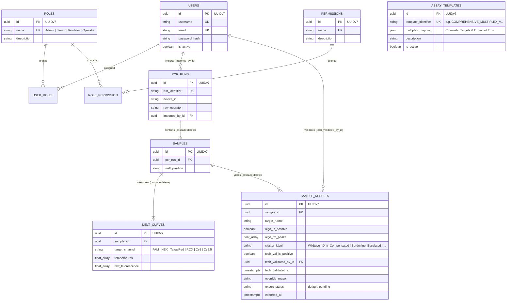

# 🧬 AI-Driven PCR Melt Curve Analyzer (WiP)


> **⚠️ DEMO ENVIRONMENT — RESEARCH USE ONLY (RUO) / GDPR & PHI COMPLIANCE**  
> *Not for clinical diagnostic procedures. This backend processes strictly anonymized thermocycler fluorescence arrays
without Protected Health Information (PHI) or patient identifiers. Every API response enforces the `X-Compliance-Notice`
HTTP header, and file uploads require an explicit GDPR/PHI anonymization consent payload (`consent_gdpr_phi=true`).*

---

## 🔬 Overview & Scientific Motivation

Standard commercial PCR thermocycler software relies on rigid, static temperature windows to call targets in multiplex
melt curve assays. When buffer variations, salt gradients, or high-concentration amplification biases occur, melting
temperatures ($T_m$) shift across the plate—causing false negatives or manual re-analysis.

The **AI-Driven PCR Melt Curve Analyzer** replaces static windows with a **dynamic, four-stage mathematical and
unsupervised Machine Learning pipeline**:

1. **Intrinsic NTC Quality Control & Blanking:** Evaluates the Negative Control (NTC) via Median Absolute
   Deviation ($\sigma_{\text{MAD}}$) on the first derivative and subtracts uncontaminated background fluorescence.
2. **Adaptive Savitzky-Golay Derivative ($-\mathrm{d}\text{RFU}/\mathrm{d}T$):** Dynamically scales smoothing windows to
   the physical temperature resolution ($\Delta T$) to extract sharp melting peaks.
3. **Asymmetric Least Squares (ALS) Baseline Correction & Gaussian Deconvolution:** Removes residual baseline drift on
   the derivative spectrum and separates overlapping shoulder peaks via multi-Gaussian non-linear least-squares
   optimization (`scipy.optimize.curve_fit`).
4. **Plate-Wide Unsupervised Clustering (`DBSCAN` & `NearestNeighbors`):** Pools extracted $T_m$ peaks per optical
   channel across the run to detect systematic thermal matrix drift, isolate primer-dimer outliers (`label == -1`), and
   assign semantic classifications (`Wildtype`, `Drift_Compensated`, `Borderline_Escalated`, `Ambiguous_Outlier`,
   `Negative`).

---

## 🏗️ Architecture & Technical Standards

We enforce a strict **Separation of Concerns (SoC)**. HTTP delivery, domain orchestration, signal processing, file
parsing, and database persistence are completely decoupled:

```text
meltcurveanalyzer/
├── app/                                    # Application Source Code
│   ├── api/                                # Flask REST Blueprints, RBAC Decorators & Defensive Payload Schemas
│   ├── core/                               # Signal Processing (ALS, SavGol, Gauss-Fit) & ML (DBSCAN, k-NN)
│   ├── db/                                 # SQLAlchemy 2.1 Models, PEP 750 Repositories & Automated DB Seeder
│   ├── ingestion/                          # Roche LightCycler XML & Block-CSV Stream Parser
│   └── services/                           # Orchestration & Business Logic (AnalysisService)
├── data/                                   # Demo Cycler Exports (e.g., demo_6channel_run.csv)
├── migrations/                             # Alembic Database Migration Scripts
├── tests/                                  # Full TDD Test Suite (Unit, Service & Live PostgreSQL Integration)
├── Dockerfile                              # Python 3.14 Production Image with uv & Gunicorn
├── docker-compose.yml                      # Orchestrates PostgreSQL 18 + Flask API with Auto-Seeding
├── MeltCurveAnalyzer_Postman_Collection.json # Ready-to-use Postman v2.1.0 Collection with Auto-JWT Script
├── main.py                                 # Flask Application Factory & Teardown Transaction Guard
├── wsgi.py                                 # Gunicorn WSGI Entrypoint
└── pyproject.toml                          # Bleeding-Edge Python 3.14 Dependency Specification
```

### 📌 Architecture Guidelines & Compatibility Standards

- **Python >=3.14 & PEP 750 Template Strings (`t"..."`):** All raw SQL statements inside `app/db/repositories.py` and
  `app/api/routes.py` must use Python 3.14 `t"..."` template strings wrapped in SQLAlchemy's `tstring()` construct to
  guarantee structural immunity against SQL injection.
- **SQLAlchemy 2.1.0b3 & psycopg 3:** Primary keys exclusively use native UUIDv7 (`uuid.uuid7`), timestamps use
  timezone-aware `DateTime(timezone=True)`, and array columns use `ARRAY(Float).with_variant(JSON, "sqlite")` so unit
  tests run in-memory on SQLite while integration and production environments leverage native PostgreSQL arrays.

---

## 🗄️ Database Entity-Relationship Diagram (ERD)



---

## 🚀 Quickstart: One-Command Docker Deployment

You can spin up the entire stack (PostgreSQL 18 + Automated Database Bootstrap/Seeding + Gunicorn/Flask API) with a
single command:

```bash
docker compose up --build -d
```

### What happens automatically in the background (`app/db/seed.py`)?

1. **Database Readiness Check:** The API container waits until the `postgres:18-alpine` healthcheck passes.
2. **Migrations & Schema Sync:** Executes `alembic upgrade head` and verifies all tables via
   `Base.metadata.create_all()`.
3. **RBAC & Default User Seeding:** Creates the roles (`Admin`, `Senior`, `Validator`, `Operator`) and provisions three
   ready-to-use accounts:

- **Master Admin:** `admin_master` / `AdminMasterPassword2026!` *(Roles: Admin, Senior, Validator, Operator)*
- **Senior Validator:** `senior_validator` / `SeniorPass2026!` *(Roles: Senior, Validator)*
- **Lab Operator:** `lab_operator` / `OperatorPass2026!` *(Role: Operator)*

4. **6-Channel / 12-Target Assay Template Seeding:** Creates the active template `COMPREHENSIVE_MULTIPLEX_V1` with 6
   optical channels and 2 expected $T_m$ peaks per channel:

| Optical Channel | Wavelength (nm) | Target 1 ($T_m$)                               | Target 2 ($T_m$)                             |
|:----------------|:----------------|:-----------------------------------------------|:---------------------------------------------|
| **FAM**         | 465–510         | SARS-CoV-2_N_Gene ($78.5\,^\circ\text{C}$)     | SARS-CoV-2_E_Gene ($83.2\,^\circ\text{C}$)   |
| **HEX**         | 540–580         | Influenza_A_M1 ($76.0\,^\circ\text{C}$)        | Influenza_B_NS1 ($81.5\,^\circ\text{C}$)     |
| **TexasRed**    | 540–610         | RSV_A_Polymerase ($74.8\,^\circ\text{C}$)      | RSV_B_Nucleocapsid ($80.4\,^\circ\text{C}$)  |
| **ROX**         | 610–670         | Adenovirus_Hexon ($77.2\,^\circ\text{C}$)      | hMPV_Fusion_Gene ($84.0\,^\circ\text{C}$)    |
| **Cy5**         | 680–700         | Rhinovirus_5UTR ($75.5\,^\circ\text{C}$)       | Parainfluenza_Type3 ($82.0\,^\circ\text{C}$) |
| **Cy5.5**       | >700            | Mycoplasma_pneumoniae ($79.0\,^\circ\text{C}$) | IC_Human_RNaseP ($85.5\,^\circ\text{C}$)     |

To inspect the bootstrap logs in real time:

```bash
docker compose logs -f api
```

---

## 📬 Evaluating the API with Postman (Auto-Token Workflow)

1. Open Postman and click **Import**.
2. Select `MeltCurveAnalyzer_Postman_Collection.json` from the project root directory.
3. Open folder **Authentication & Identity**.
4. Run **1.1 Login as Admin (`admin_master`) [Auto-Saves JWT]**.

- *Zero Manual Copy-Pasting:* A built-in Post-Response script automatically extracts `access_token` from the JSON
  response and stores it in the collection/environment variable `{{jwt_token}}`.
- All subsequent requests in folders **2 (Users)**, **3 (Templates)**, **4 (Runs & Ingestion)**, and **5 (Technical
  Validation)** inherit `Bearer {{jwt_token}}` automatically.

5. For **4.1 Upload Cycler Run File**, select the included `data/demo_6channel_run.csv` file in the file `form-data`
   field and click **Send**. The Post-Response script automatically captures `{{run_id}}` and `{{result_id}}` for
   requests `4.3` and `5.1`.

---

## 🧪 Running the Test Suite Locally

Make sure the PostgreSQL container is running (`docker compose up -d db`), then execute:

```bash
cp .env.example .env
docker compose up -d db
uv run pytest -v
```

---

## 🔒 GDPR, PHI & Regulatory Compliance Notice

- **Strict Anonymization:** This software is designed for Research Use Only (RUO) and local offline/intranet laboratory
  evaluation. Do not upload files containing patient names, birthdates, or hospital case numbers.
- **Mandatory Consent Gate:** `POST /api/runs/upload` rejects any upload missing the explicit form field
  `consent_gdpr_phi=true` with `400 Bad Request`.
- **Audit Trail Preservation:** Deleting users (`DELETE /api/users/<id>`) or assay templates (
  `DELETE /api/templates/<id>`) performs a non-destructive soft-deactivate (`is_active = False`) to preserve historical
  foreign-key integrity and technical validation audit logs.
